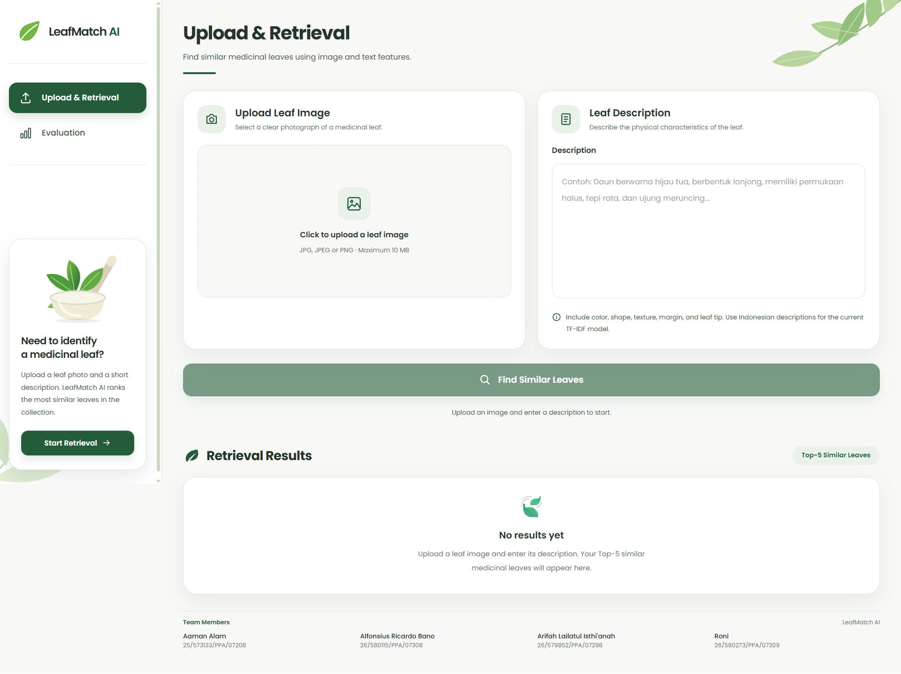
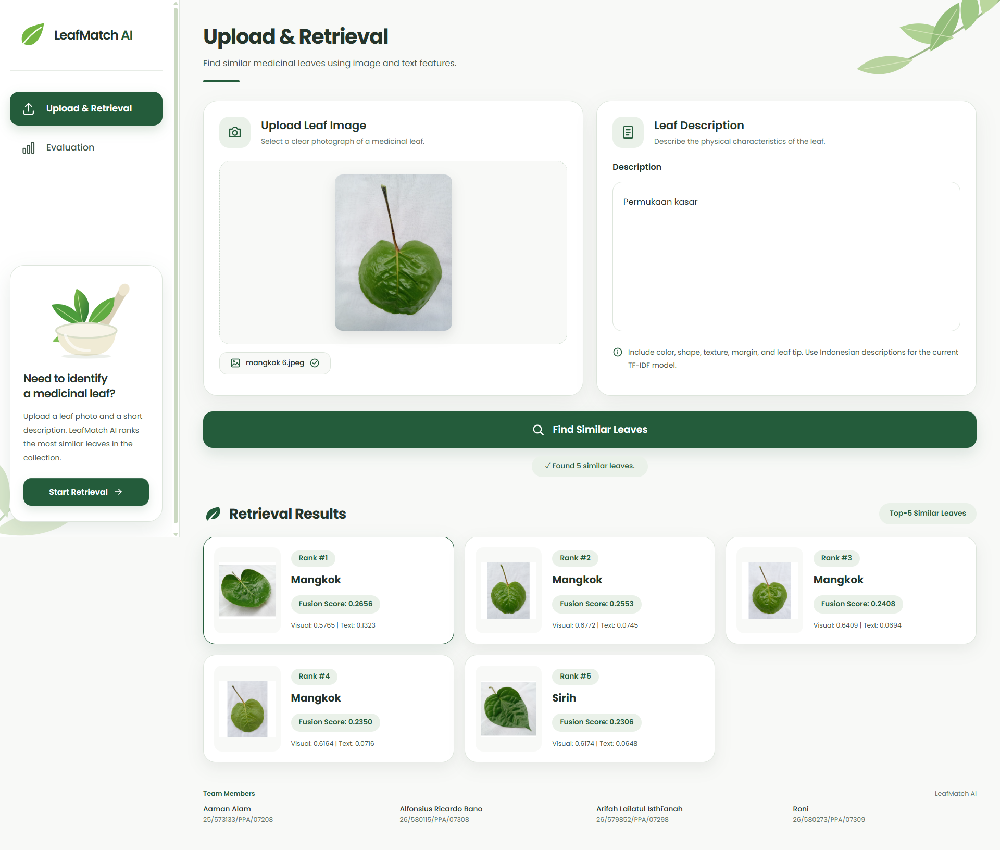
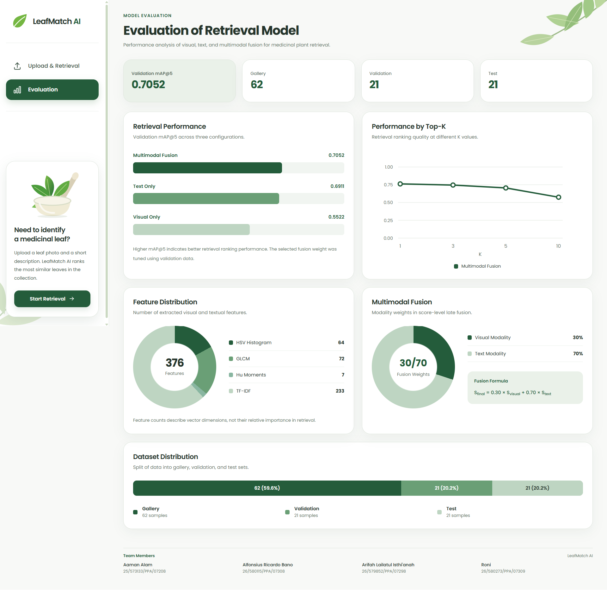

## Application Screenshots

LeafMatch AI is a Flask-based web application for retrieving similar medicinal plant leaves using visual and textual features.

### 1. Upload & Retrieval Interface

Users can upload a medicinal leaf image and enter a textual description to initiate the retrieval process.

### 2. Top-5 Retrieval Results

The system calculates visual and textual similarity, combines the scores using Weighted Late Fusion, and displays the five most similar leaf samples.

### 3. Model Evaluation Dashboard

The evaluation dashboard presents retrieval performance, feature distributions, fusion weights, and dataset partitions.

